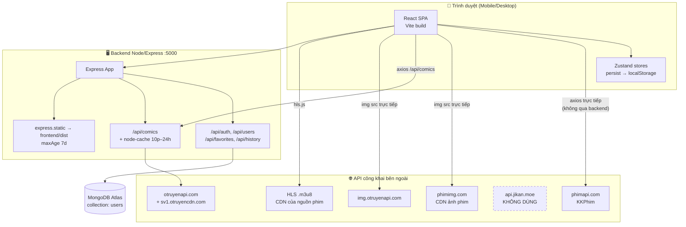

# LDMovies & Comics — Báo cáo Rà soát Toàn diện

> **Ngày:** 2026-08-05
> **Phạm vi:** Toàn bộ dự án (`frontend/` + `backend/`), tập trung vào **mức tiêu thụ data di động (mobile data usage)** và **thiết kế hệ thống (system design)**.
> **Commit:** `76fcf84` (main, clean tree)

---

## 1. Tóm tắt điều hành

LDMovies là một SPA React 18 + Vite 7 đóng vai trò **client mỏng đứng trước 3 API công khai bên ngoài** (phimapi/KKPhim, OTruyen, Jikan), cộng thêm một backend Express + MongoDB chỉ phục vụ **tài khoản, yêu thích, lịch sử** và **proxy có cache cho truyện tranh**. Kiến trúc này gọn, chi phí vận hành gần bằng 0, và đã có một số tối ưu tốt sẵn có (gzip, HLS data-saver mặc định 480p mobile, code-splitting theo route, `node-cache` phía backend).

Tuy nhiên có **3 vấn đề lớn về data di động** và **2 lỗi tiềm ẩn nghiêm trọng về đúng đắn/bảo mật**:

| # | Vấn đề | Ảnh hưởng | Mức |
|---|--------|-----------|-----|
| 1 | Đọc 1 chương truyện tải **~7–9 MB ảnh gốc** không qua tối ưu | Ngốn data nhất toàn hệ thống | 🔴 P0 |
| 2 | HLS đặt `startLevel` **sau** `MANIFEST_PARSED` → vài segment đầu tải ở chất lượng auto/cao | Lãng phí 5–20 MB mỗi lần mở tập | 🔴 P0 |
| 3 | Ảnh poster tải nguyên gốc (~40 KB/ảnh), trang chủ ~20 ảnh + 5 ảnh hero **eager** | Trang chủ ~1.0–1.4 MB | 🟠 P1 |
| 4 | `index.html` bị cache 7 ngày (`express.static maxAge:'7d'`) | User kẹt ở build cũ, trắng trang sau deploy | 🔴 P0 |
| 5 | Mongoose `pre('save')` thiếu `return next()` → re-hash mật khẩu / unhandled rejection | Rủi ro khóa tài khoản | 🔴 P0 |
| 6 | CORS whitelist dùng `origin.includes('.vercel.app')` | Bypass bằng domain `x.vercel.app.evil.com` | 🟠 P1 |

**Điểm đánh giá tổng thể**

| Hạng mục | Điểm | Ghi chú |
|---|---|---|
| Kiến trúc & phân tách | 7/10 | Rõ ràng, nhưng có lớp API chết & README lệch code |
| Hiệu năng / Data usage | 4/10 | Chưa có image proxy, chưa có SW, HLS cấu hình sai thời điểm |
| Bảo mật | 5/10 | JWT trong localStorage + CSP tắt + CORS lỏng |
| Chất lượng code | 6/10 | Comment tiếng Việt tốt, nhưng ~450 dòng code chết, 0 test |
| DevOps / Repo | 4/10 | `cloudflared.exe` 53 MB commit vào git, không CI/lint |
| UX / A11y | 6/10 | Chặn pinch-zoom, thiếu error boundary |

---

## 2. Kiến trúc hệ thống hiện tại



**Nhận xét kiến trúc:**

- ✅ Backend **không** proxy API phim → giảm băng thông server, tận dụng cache trình duyệt trực tiếp từ CDN nguồn.
- ⚠️ Nhưng cũng có nghĩa là **không có điểm nào để can thiệp tối ưu ảnh** — đây chính là gốc rễ của vấn đề data.
- ⚠️ Truyện tranh thì ngược lại: JSON đi qua backend (tốt, có cache) nhưng **ảnh chương thì đi thẳng CDN** (xấu, không tối ưu được).
- ⚠️ Toàn bộ dữ liệu người dùng nằm trong **1 document `User` duy nhất** với các mảng lồng nhau (`favorites.movies/anime/comics`, `watchHistory`, `comicHistory`) — sẽ là nút thắt khi scale.

---

## 3. Phân tích Data Usage (Mobile)

### 3.1 Số liệu đo thực tế

Các con số dưới đây được **đo trực tiếp bằng `curl`** trên các endpoint/CDN mà app đang gọi (ngày 2026-08-05):

| Tài nguyên | Kích thước thô | Sau gzip | Cache-Control |
|---|---|---|---|
| `phimapi /danh-sach/phim-le?limit=24` | 32.7 KB | **7.6 KB** | — |
| `phimapi /phim/:slug` (phim lẻ) | 2.5 KB | 1.5 KB | — |
| Poster phim `.webp` 500×750 | **40.5 KB** | (đã nén) | `max-age=14400` (4h) |
| Thumb phim `.webp` | 23.3 KB | — | `max-age=14400` |
| `otruyenapi /danh-sach/truyen-moi` (24 mục) | 20.1 KB | **4.0 KB** | — |
| `otruyenapi /truyen-tranh/:slug` (110 chương) | 26.0 KB | — | — |
| Thumb truyện `.jpg` | **64.4 KB** | — | `max-age=31536000` (1 năm) |
| JSON 1 chương truyện | 1.8 KB | — | — |
| **1 trang ảnh chương truyện** (900×2658, JPEG q70) | **~228 KB TB** (min 64 KB, max 388 KB) | — | — |
| **1 chương = 33 trang** | **≈ 7.3 MB** | — | — |
| Google Fonts CSS (Inter, 5 weights) | 12.5 KB | — | — |

### 3.2 Ước tính data theo màn hình

> Phần JS/CSS là **ước tính** (không chạy được `vite build` trong môi trường rà soát vì thiếu Node runtime). Con số dựa trên kích thước gzip đã biết của từng thư viện.

| Màn hình / Hành động | Data lần đầu | Data lần sau (cache còn hạn) |
|---|---|---|
| **Trang chủ phim** | **~1.0 – 1.4 MB** | ~0.2 – 0.5 MB |
| ├─ JS (react-vendor + ui-vendor + index + HomePage) | ~110–140 KB gz | 0 (cache 7d) |
| ├─ CSS (Tailwind) | ~15 KB gz | 0 |
| ├─ Google Fonts (5 weights × latin+vi) | ~60–80 KB | 0 (cache 1 năm) |
| ├─ 4 API call KKPhim | ~30 KB gz | 0 (cache RAM 5 phút) |
| ├─ **5 ảnh Hero (eager, không lazy)** | **~150–250 KB** | 0 (4h) |
| └─ ~12–20 poster hiển thị | ~480–800 KB | 0 (4h) |
| **Trang chi tiết phim** | ~200 KB + **chunk `player-vendor` ~120 KB gz** | ~1.5 KB |
| **Xem phim 480p — 24 phút** | **~150 – 270 MB** | — |
| **Xem phim 720p — 45 phút** | **~700 – 900 MB** | — |
| **Xem phim 1080p — 45 phút** | **~1.4 – 1.6 GB** | — |
| **Trang chủ truyện** | ~1.6 MB (24 thumb × 64 KB) | ~0 (cache 1 năm) |
| **Đọc 1 chương truyện** | **~7.3 MB** | ~0 |
| **Đọc 20 chương liên tiếp** | **~145 MB** | — |

### 3.3 Xếp hạng "kẻ ngốn data"

```
1. 🎬 Video HLS          ██████████████████████████████  ~95%
2. 📖 Ảnh chương truyện  ████                             ~3%
3. 🖼️ Poster/thumbnail   █                                ~1.5%
4. 📦 JS/CSS/Fonts       ▎                                ~0.3%
5. 📄 API JSON           ▏                                ~0.2%
```

**Kết luận:** mọi tối ưu về JS bundle chỉ là "làm đẹp". **Muốn giảm data thật sự phải đánh vào video và ảnh chương truyện.**

---

## 4. Phương án tối ưu Data Usage

### 🔴 P0-1 — Sửa lỗi HLS tải segment đầu ở chất lượng cao

**Vấn đề** (`frontend/src/components/VideoPlayer.jsx:288-350`):

```js
const hls = new Hls({ enableWorker: true, maxBufferLength: 30, ... });
hls.attachMedia(video);
hls.on(Hls.Events.MEDIA_ATTACHED, () => hls.loadSource(videoUrl));

hls.on(Hls.Events.MANIFEST_PARSED, (event, data) => {
    ...
    hls.startLevel = targetLevel.originalIndex;   // ❌ QUÁ MUỘN
    hls.currentLevel = targetLevel.originalIndex;
});
```

`hls.startLevel` chỉ có tác dụng **trước khi** manifest được parse. Gán ở `MANIFEST_PARSED` là sau thời điểm hls.js đã chọn level khởi động và bắt đầu request fragment đầu tiên. Trên mạng 4G tốt, ABR có thể chọn 1080p → tải 1–3 segment (mỗi segment 6–10 s ở ~5 Mbps ≈ 4–6 MB) rồi mới nhảy xuống 480p.

**Lãng phí ước tính: 5–20 MB mỗi lần mở/đổi tập.**

**Sửa:**

```js
// Đọc preference TRƯỚC khi khởi tạo Hls
const savedQuality = localStorage.getItem('ldmovies_quality');
const isMobileScreen = window.innerWidth <= 768;
const isAuto = savedQuality === 'Auto' || savedQuality === '-1';
const targetHeight = savedQuality && !isAuto
    ? parseInt(savedQuality, 10)
    : (isMobileScreen ? 480 : 720);

const hls = new Hls({
    enableWorker: true,
    lowLatencyMode: false,
    maxBufferLength: 30,
    maxMaxBufferLength: 60,

    // ── Data saver ────────────────────────────────────────────────
    startLevel: isAuto ? -1 : 0,        // 0 = level thấp nhất, an toàn nhất khi khởi động
    capLevelToPlayerSize: true,         // không tải quality > kích thước player thực tế
    capLevelOnFPSDrop: true,
    maxBufferSize: 20 * 1000 * 1000,    // 20 MB thay vì mặc định 60 MB
    backBufferLength: 30,               // xả buffer đã xem, giảm RAM
    abrEwmaDefaultEstimate: 800_000,    // giả định 800 kbps ban đầu thay vì 5 Mbps
    startFragPrefetch: false,
});
hlsRef.current = hls;
hls.attachMedia(video);
hls.on(Hls.Events.MEDIA_ATTACHED, () => hls.loadSource(videoUrl));

hls.on(Hls.Events.MANIFEST_PARSED, (event, data) => {
    // ... phần lọc levels giữ nguyên ...
    if (!isAuto && targetLevel) {
        hls.currentLevel = targetLevel.originalIndex;   // chỉ cần currentLevel ở đây
    }
});
```

Riêng `capLevelToPlayerSize: true` đã là một chiến thắng lớn: trên điện thoại player rộng ~390 px CSS → hls.js sẽ không bao giờ chọn 1080p.

### 🔴 P0-2 — Dừng tải khi tab ẩn / khóa màn hình

Hiện tại khi user chuyển app hoặc tắt màn hình, hls.js **vẫn tiếp tục buffer**. Thêm vào `VideoPlayer.jsx`:

```js
useEffect(() => {
    const onVisibility = () => {
        const hls = hlsRef.current;
        if (!hls) return;
        if (document.hidden && videoRef.current?.paused) {
            hls.stopLoad();          // ngừng tải fragment
        } else if (!document.hidden) {
            hls.startLoad();
        }
    };
    document.addEventListener('visibilitychange', onVisibility);
    return () => document.removeEventListener('visibilitychange', onVisibility);
}, []);
```

### 🔴 P0-3 — Image proxy cho ảnh chương truyện (giảm ~60–70% data đọc truyện)

Ảnh chương hiện tại: **900×2658 px, JPEG quality 70, ~228 KB/trang**, tải thẳng từ `sv1.otruyencdn.com`, không thể can thiệp.

Backend đã là proxy cho JSON truyện rồi → mở rộng thành proxy ảnh có resize:

```bash
cd backend && npm i sharp
```

```js
// backend/controllers/imageProxyController.js
import axios from 'axios';
import sharp from 'sharp';

const ALLOWED_HOSTS = new Set([
  'sv1.otruyencdn.com', 'img.otruyenapi.com', 'phimimg.com',
]);

export const proxyImage = async (req, res) => {
  try {
    const { url, w = 720, q = 60, fmt = 'webp' } = req.query;
    if (!url) return res.status(400).json({ message: 'Thiếu url' });

    const target = new URL(url);
    if (!ALLOWED_HOSTS.has(target.hostname)) {          // ⚠️ chống SSRF
      return res.status(403).json({ message: 'Host không được phép' });
    }

    const width = Math.min(parseInt(w, 10) || 720, 1280);
    const quality = Math.min(Math.max(parseInt(q, 10) || 60, 30), 85);

    const upstream = await axios.get(target.href, {
      responseType: 'arraybuffer',
      timeout: 15000,
      maxContentLength: 15 * 1024 * 1024,
    });

    const pipeline = sharp(upstream.data).resize({ width, withoutEnlargement: true });
    const out = fmt === 'avif'
      ? await pipeline.avif({ quality: quality - 10 }).toBuffer()
      : await pipeline.webp({ quality }).toBuffer();

    res.set({
      'Content-Type': `image/${fmt}`,
      'Cache-Control': 'public, max-age=31536000, immutable',
      'Content-Length': out.length,
    });
    res.end(out);
  } catch (err) {
    console.error('[img-proxy]', err.message);
    res.status(502).json({ message: 'Không tải được ảnh' });
  }
};
```

```js
// backend/routes/imageRoutes.js  →  app.use('/api/img', imageRoutes)
router.get('/', proxyImage);
```

Frontend (`ComicReaderPage.jsx:178`):

```jsx
const IMG_PROXY = import.meta.env.VITE_API_URL || '/api';
const dataSaver = localStorage.getItem('ldmovies_datasaver') === '1';
const targetW = dataSaver ? 540 : Math.min(Math.round(window.innerWidth * (window.devicePixelRatio || 1)), 900);
const targetQ = dataSaver ? 45 : 62;


```

**Kết quả dự kiến:**

| Chế độ | Kích thước/trang | 1 chương (33 trang) | Tiết kiệm |
|---|---|---|---|
| Hiện tại (JPEG 900px q70) | ~228 KB | **7.3 MB** | — |
| WebP 900px q62 | ~95 KB | **3.1 MB** | **−57%** |
| WebP 540px q45 (Data Saver) | ~48 KB | **1.6 MB** | **−78%** |

⚠️ Lưu ý vận hành: proxy này chuyển băng thông ảnh từ CDN nguồn về server bạn. Với self-host qua Cloudflare Tunnel thì băng thông upload nhà bạn sẽ là nút thắt → **bắt buộc** phải cache đĩa kết quả (xem P1-4).

### 🟠 P1-1 — Thêm "Chế độ tiết kiệm data" (Data Saver) toàn cục

Một store nhỏ, bật/tắt từ Navbar, tự bật khi phát hiện mạng chậm:

```js
// frontend/src/stores/dataSaverStore.js
import { create } from 'zustand';
import { persist } from 'zustand/middleware';

const detectDefault = () => {
  const c = navigator.connection;
  if (!c) return false;
  return c.saveData === true || ['slow-2g', '2g', '3g'].includes(c.effectiveType);
};

const useDataSaver = create(persist((set) => ({
  enabled: detectDefault(),
  toggle: () => set((s) => ({ enabled: !s.enabled })),
}), { name: 'ldmovies-datasaver' }));

export default useDataSaver;
```

Khi bật:

| Thành phần | Hành vi bình thường | Data Saver |
|---|---|---|
| Video HLS | 480p mobile / 720p desktop | **Ép 360p, `maxBufferLength: 15`** |
| Ảnh chương truyện | WebP 900px q62 | WebP 540px q45 |
| Poster | WebP gốc 500px | WebP 300px q55 qua proxy |
| Hero carousel | 5 ảnh, auto-slide 4s | **Chỉ 1 ảnh, tắt auto-slide** |
| Prefetch on hover | Bật | **Tắt** |

### 🟠 P1-2 — Sửa Hero Section: 5 ảnh eager → 1 ảnh + preload

`frontend/src/components/HeroSection.jsx:412` render **tất cả** slide cùng lúc, mỗi slide có `` không `loading`, không `fetchpriority`. Cả 5 ảnh tải ngay lập tức dù chỉ 1 ảnh hiển thị.

```jsx

```

Tốt hơn nữa: chỉ render slide `currentIndex` và `currentIndex + 1` thay vì `movies.map()` toàn bộ. **Tiết kiệm ~120–200 KB ngay ở first load.**

Đồng thời `animate-slow-zoom` (`20s ease-in-out infinite alternate`) chạy vô hạn trên ảnh full-viewport → tốn pin/GPU trên mobile. Nên bọc trong `@media (prefers-reduced-motion: no-preference)` và tắt khi Data Saver bật.

### 🟠 P1-3 — Service Worker: cache ảnh + app shell

Không có SW → mỗi lần mở lại app (sau 4h) toàn bộ poster tải lại. Với Vite:

```bash
cd frontend && npm i -D vite-plugin-pwa
```

```js
// vite.config.js
import { VitePWA } from 'vite-plugin-pwa';

plugins: [
  react(),
  VitePWA({
    registerType: 'autoUpdate',
    workbox: {
      globPatterns: ['**/*.{js,css,html,svg,woff2}'],
      runtimeCaching: [
        {
          urlPattern: /^https:\/\/(phimimg\.com|img\.otruyenapi\.com)\/.*/i,
          handler: 'CacheFirst',
          options: {
            cacheName: 'poster-cache',
            expiration: { maxEntries: 400, maxAgeSeconds: 60 * 60 * 24 * 30 },
            cacheableResponse: { statuses: [0, 200] },
          },
        },
        {
          urlPattern: /\/api\/(comics|img)\/.*/i,
          handler: 'StaleWhileRevalidate',
          options: {
            cacheName: 'api-cache',
            expiration: { maxEntries: 200, maxAgeSeconds: 60 * 60 * 6 },
          },
        },
      ],
      // ⚠️ KHÔNG cache video/HLS — sẽ phình quota
      navigateFallbackDenylist: [/^\/api\//],
    },
    manifest: {
      name: 'LDMovies & Comics',
      short_name: 'LDMovies',
      theme_color: '#09090B',
      background_color: '#09090B',
      display: 'standalone',
      start_url: '/',
    },
  }),
]
```

**Tiết kiệm ~0.5–1.5 MB/phiên** với người dùng quay lại thường xuyên, và cho phép cài như app trên màn hình chính.

### 🟠 P1-4 — Cache đĩa cho image proxy

`node-cache` giữ trong RAM — không hợp với ảnh. Dùng cache file:

```js
import crypto from 'crypto';
import fs from 'fs/promises';
import path from 'path';

const CACHE_DIR = path.join(process.cwd(), '.cache', 'img');
const key = (url, w, q, fmt) =>
  crypto.createHash('sha1').update(`${url}|${w}|${q}|${fmt}`).digest('hex') + '.' + fmt;

// trong proxyImage, trước khi gọi upstream:
const file = path.join(CACHE_DIR, key(target.href, width, quality, fmt));
try {
  const cached = await fs.readFile(file);
  res.set({ 'Content-Type': `image/${fmt}`, 'Cache-Control': 'public, max-age=31536000, immutable', 'X-Cache': 'HIT' });
  return res.end(cached);
} catch { /* miss → tải upstream */ }
// ... sau khi resize:
await fs.mkdir(CACHE_DIR, { recursive: true });
fs.writeFile(file, out).catch(() => {});   // fire-and-forget
```

Kèm cron dọn file cũ hơn 30 ngày (hoặc giới hạn tổng dung lượng).

### 🟠 P1-5 — HTTP cache header cho API truyện

`backend/controllers/comicController.js` có `node-cache` phía server nhưng **không gửi cache header** → trình duyệt gọi lại mỗi lần điều hướng.

```js
// helper dùng chung
const sendCached = (res, data, maxAge = 300) => {
  res.set('Cache-Control', `public, max-age=${maxAge}, stale-while-revalidate=${maxAge * 2}`);
  return res.json(data);
};

// getLatestComics  → sendCached(res, result, 300)      (5 phút)
// getComicDetails  → sendCached(res, result, 600)      (10 phút)
// getComicChapter  → sendCached(res, data, 86400)      (chương không đổi → 1 ngày)
// getGenres        → sendCached(res, data, 86400)
```

Bổ sung `app.set('etag', 'strong')` để hưởng lợi 304 Not Modified (~0 byte body).

### 🟡 P2-1 — Giảm JS bundle

| Việc cần làm | Tiết kiệm ước tính |
|---|---|
| Xóa `react-player` khỏi `package.json` **và** khỏi `manualChunks` — **không có file nào import nó** | ~35 KB gz (tránh rủi ro bị gộp nhầm) |
| Đổi `import Hls from 'hls.js'` → `hls.js/dist/hls.light.mjs` (bỏ EME/subtitle/alt-audio) | ~30 KB gz |
| `const VideoPlayer = lazy(() => import('../components/VideoPlayer'))` trong 2 trang detail | ~120 KB gz **không tải** nếu user chỉ xem thông tin |
| Xóa `frontend/src/services/jikanApi.js` (221 dòng, không nơi nào dùng) | dead code |
| Xóa `frontend/src/pages/WatchPage.jsx` (226 dòng, **không đăng ký route** trong `App.jsx`) | dead code |
| Xóa `movieApi`/`genreApi`/`episodeApi`/`animeApi` trong `services/api.js` — gọi tới các endpoint **backend không hề có** | dead code |

### 🟡 P2-2 — Self-host font, giảm số weight

`index.html` load Inter với **5 weight (300/400/500/600/700)**. Mỗi weight × (latin + latin-ext + vietnamese + cyrillic…) = nhiều file woff2. CSS riêng đã 12.5 KB.

```html
<!-- Thay thế: self-host variable font, subset latin + vietnamese -->
<link rel="preload" href="/fonts/inter-var-latin-vn.woff2" as="font" type="font/woff2" crossorigin>
```

```css
@font-face {
  font-family: 'Inter';
  font-style: normal;
  font-weight: 300 700;         /* variable */
  font-display: swap;
  src: url('/fonts/inter-var-latin-vn.woff2') format('woff2');
  unicode-range: U+0000-00FF, U+0102-0103, U+0110-0111, U+0128-0129, U+0168-0169,
                 U+01A0-01A1, U+01AF-01B0, U+1EA0-1EF9, U+20AB;
}
```

Tiết kiệm ~40–60 KB + loại bỏ 2 DNS/TLS handshake tới `fonts.googleapis.com` và `fonts.gstatic.com` (đáng kể trên 3G/4G yếu).

### 🟡 P2-3 — Nén tĩnh trước (precompress)

`compression()` nén lại JS/CSS **mỗi request**, và chỉ gzip. Thêm brotli tiền nén:

```js
// vite.config.js
import viteCompression from 'vite-plugin-compression';
plugins: [react(), viteCompression({ algorithm: 'brotliCompress', ext: '.br' })]
```

Brotli nén JS tốt hơn gzip ~15–20% và không tốn CPU server lúc chạy.

### 📊 Tổng hợp tác động dự kiến

| Kịch bản | Hiện tại | Sau P0+P1 | Giảm |
|---|---|---|---|
| Mở app + lướt trang chủ | ~1.2 MB | **~0.45 MB** | −62% |
| Mở app lần 2 (trong ngày) | ~0.35 MB | **~0.03 MB** | −91% |
| Mở 1 tập phim (segment đầu) | 8–25 MB lãng phí | **~1 MB** | −90% |
| Xem 24 phút anime 480p | ~200 MB | ~200 MB* | 0% |
| Xem 24 phút với Data Saver 360p | — | **~90 MB** | −55% |
| Đọc 1 chương truyện | 7.3 MB | **3.1 MB** (1.6 MB nếu Data Saver) | −57% / −78% |
| Đọc 20 chương | 145 MB | **62 MB** (32 MB Data Saver) | −57% / −78% |

\* Video ở cùng độ phân giải thì bitrate do nguồn quyết định — chỉ giảm được bằng cách hạ resolution.

---

## 5. Rà soát toàn diện

### 5.1 Backend & System Design

#### 🔴 `index.html` bị cache 7 ngày — user kẹt ở build cũ

`backend/server.js:112-120`:

```js
app.use(express.static(frontendDistPath, { maxAge: '7d', etag: true }));
app.get('*', (req, res) => res.sendFile(distIndexHtml));
```

`express.static` phục vụ cả `index.html` với `max-age=604800`. Sau khi deploy build mới, các file `assets/*.[hash].js` cũ biến mất nhưng trình duyệt vẫn giữ `index.html` cũ trỏ tới chúng → **trắng trang** cho tới khi user xóa cache. Rất khó chịu trên mobile.

```js
// Sửa: tài sản có hash → cache vĩnh viễn; index.html → không cache
app.use(express.static(frontendDistPath, {
  index: false,                    // không tự phục vụ index.html
  etag: true,
  setHeaders: (res, filePath) => {
    if (/\.[0-9a-f]{8,}\.(js|css|woff2|png|jpg|svg|webp)$/i.test(filePath)) {
      res.setHeader('Cache-Control', 'public, max-age=31536000, immutable');
    } else {
      res.setHeader('Cache-Control', 'public, max-age=3600');
    }
  },
}));

app.get('*', (req, res) => {
  res.set('Cache-Control', 'no-cache, must-revalidate');
  res.sendFile(distIndexHtml);
});
```

#### 🔴 Route `/api/*` không tồn tại trả về HTML 200

`app.get('*')` bắt luôn mọi đường dẫn chưa khớp, kể cả `/api/khong-ton-tai` → trả `index.html` với status **200**. Axios sẽ parse HTML thành `response.data` là chuỗi → lỗi khó debug.

```js
// Thêm NGAY TRƯỚC app.get('*')
app.use('/api', (req, res) => {
  res.status(404).json({ message: `Không tìm thấy endpoint: ${req.method} ${req.originalUrl}` });
});
```

#### 🟠 CORS whitelist bypass được

`backend/server.js:77-84`:

```js
origin.includes('.vercel.app') || origin.includes('.onrender.com') || ...
```

`includes` kiểm tra chuỗi con, không kiểm tra hậu tố. `https://ldmovies.vercel.app.attacker.com` **pass** whitelist. Kết hợp `credentials: true` là mẫu nguy hiểm.

```js
const ALLOWED_SUFFIXES = ['.ngrok-free.dev', '.nport.link', '.mydrpet.io.vn', '.vercel.app', '.onrender.com'];

const isAllowed = (origin) => {
  if (allowedOrigins.includes(origin)) return true;
  try {
    const { hostname, protocol } = new URL(origin);
    if (protocol !== 'https:' && !hostname.startsWith('localhost')) return false;
    return ALLOWED_SUFFIXES.some((s) => hostname === s.slice(1) || hostname.endsWith(s));
  } catch { return false; }
};
```

#### 🟠 Ghi lịch sử không nguyên tử (2 round-trip)

`historyController.js:32-58` — `updateOne($pull)` rồi `findByIdAndUpdate($push)`. Hai lệnh riêng biệt: nếu request thứ hai fail hoặc có 2 tab cùng sync, có thể mất mục hoặc trùng lặp. Ngoài ra mỗi lần sync trả về **toàn bộ mảng 20 item kèm poster URL** (~3–5 KB) trong khi client không dùng response.

```js
// Gộp thành 1 lệnh bằng arrayFilters hoặc pipeline update (MongoDB 4.2+)
await User.updateOne({ _id: req.user._id }, [
  {
    $set: {
      watchHistory: {
        $slice: [
          {
            $concatArrays: [
              [newEntry],
              { $filter: {
                  input: '$watchHistory',
                  cond: { $not: { $and: [
                    { $eq: ['$$this.slug', item.slug] },
                    { $eq: ['$$this.episodeName', item.episodeName] },
                  ]}},
              }},
            ],
          },
          20,
        ],
      },
    },
  },
]);
res.status(204).end();   // client không cần body
```

#### 🟠 Middleware `protect` có 2 lỗ hổng

`backend/middleware/auth.js`:

```js
try {
  const decoded = jwt.verify(token, process.env.JWT_SECRET);
  req.user = await User.findById(decoded.id).select('-password');
  next();                       // ❌ next() nằm TRONG try
} catch (error) { return res.status(401)... }
```

1. **`next()` trong `try`**: nếu controller phía sau ném lỗi đồng bộ, `catch` ở đây sẽ chạy và cố gửi 401 sau khi response đã gửi → `ERR_HTTP_HEADERS_SENT`.
2. **Không kiểm tra `req.user` null**: nếu user đã bị xóa khỏi DB nhưng token còn hạn, `req.user` = `null` → mọi controller crash ở `req.user._id`.

```js
export const protect = async (req, res, next) => {
  const header = req.headers.authorization;
  if (!header?.startsWith('Bearer ')) {
    return res.status(401).json({ message: 'Không được phép, không có token' });
  }
  let user;
  try {
    const decoded = jwt.verify(header.split(' ')[1], process.env.JWT_SECRET);
    user = await User.findById(decoded.id).select('-password');
  } catch {
    return res.status(401).json({ message: 'Không được phép, token không hợp lệ' });
  }
  if (!user) return res.status(401).json({ message: 'Tài khoản không còn tồn tại' });
  req.user = user;
  return next();                // ✅ ngoài try
};
```

#### 🟡 `express-validator` là dependency nhưng không dùng ở đâu

`register` không validate gì ngoài schema Mongoose — email format, độ mạnh mật khẩu, và đặc biệt là **`avatar` URL trong `updateUserProfile` nhận bất kỳ chuỗi nào** (có thể là `javascript:` URI hoặc URL ảnh 20 MB do bên thứ ba host). Nên validate hoặc gỡ dependency.

#### 🟡 `helmet({ contentSecurityPolicy: false })` — tắt CSP hoàn toàn

Comment nói để không chặn embed video. Đúng là CSP mặc định của helmet quá chặt, nhưng nên khai báo policy riêng thay vì tắt sạch:

```js
app.use(helmet({
  contentSecurityPolicy: {
    directives: {
      defaultSrc: ["'self'"],
      imgSrc: ["'self'", 'data:', 'https:'],
      mediaSrc: ["'self'", 'https:', 'blob:'],
      connectSrc: ["'self'", 'https://phimapi.com', 'https:'],
      frameSrc: ['https:'],
      scriptSrc: ["'self'", "'unsafe-inline'"],  // Vite inline một số script
      styleSrc: ["'self'", "'unsafe-inline'", 'https://fonts.googleapis.com'],
      fontSrc: ["'self'", 'https://fonts.gstatic.com', 'data:'],
    },
  },
  crossOriginEmbedderPolicy: false,
}));
```

#### 🟡 Rate limit lưu trong RAM

`express-rate-limit` mặc định dùng MemoryStore → reset mỗi lần restart, và không chia sẻ giữa nhiều instance. Với self-host 1 process thì chấp nhận được, nhưng nếu deploy lên Render với >1 instance sẽ mất tác dụng. Ghi chú lại trong tài liệu vận hành.

#### 🟡 `uncaughtException` không thoát tiến trình

`server.js:141-145` cố tình không gọi `process.exit()`. Node sau `uncaughtException` ở trạng thái không xác định (có thể rò rỉ handle, giữ khóa). Thực hành đúng: **log rồi thoát**, để process manager (pm2/systemd/Docker restart policy) khởi động lại.

### 5.2 Cơ sở dữ liệu

| Vấn đề | Chi tiết | Đề xuất |
|---|---|---|
| **Mảng lồng không giới hạn** | `favorites.movies/anime/comics` không có `$slice` — user thêm 5.000 phim → document phình, mọi `findById` đều tải hết | Giới hạn (500) hoặc tách collection `Favorite` |
| **`watchHistory` giới hạn 20, `comicHistory` 50** | Tốt, nhưng giới hạn nằm rải rác trong controller | Đưa vào hằng số dùng chung |
| **Không có index** | Ngoài `unique` trên `username`/`email` (tạo index tự động), không có index nào khác. Hiện tại mọi truy vấn đều theo `_id` nên ổn | Khi tách collection thì cần `{ userId: 1, updatedAt: -1 }` |
| **`avatar` default `https://via.placeholder.com/150`** | Dịch vụ này đã **ngừng hoạt động** — mọi avatar mặc định là ảnh hỏng | Đổi sang data-URI SVG hoặc `ui-avatars.com` (Navbar đã dùng) |
| **Không có `Movie`/`Episode` model** | Nhưng `services/api.js` gọi `/movies`, `/episodes` | Xóa lớp API chết |

#### 🔴 Lỗi Mongoose `pre('save')` — nghiêm trọng

`backend/models/User.js:96-104`:

```js
userSchema.pre('save', async function (next) {
  if (!this.isModified('password')) {
    next();                    // ❌ thiếu `return`
  }
  const salt = await bcrypt.genSalt(10);
  this.password = await bcrypt.hash(this.password, salt);
});
```

Thiếu `return` nghĩa là **luồng vẫn chạy tiếp sau `next()`**. Hai hệ quả:

1. **Khi thêm/xóa favorite** (`favoritesController` gọi `user.save()` với document không select `password`): `this.password` là `undefined` → `bcrypt.hash(undefined, salt)` ném lỗi → **unhandled rejection** (hiện đang bị nuốt bởi handler `process.on('unhandledRejection')` ở `server.js`, nên không crash nhưng cũng không ai biết).
2. **Nếu document có load `password`**: mật khẩu đã hash bị **hash lại lần nữa** một cách bất đồng bộ, đua với thao tác ghi của Mongoose → nguy cơ **user không đăng nhập được nữa**.

```js
userSchema.pre('save', async function () {
  if (!this.isModified('password')) return;      // ✅ hook async: chỉ cần return
  const salt = await bcrypt.genSalt(10);
  this.password = await bcrypt.hash(this.password, salt);
});
```

(Với hook `async`, **không** trộn lẫn `next()` và `await` — chọn một trong hai.)

### 5.3 Frontend

| Vấn đề | Vị trí | Ghi chú |
|---|---|---|
| 🟠 **Không có Error Boundary** | `App.jsx` | Một lỗi render → toàn app trắng trang. Bọc `<Suspense>` bằng `ErrorBoundary` |
| 🟠 **`pt-16` vs Navbar `h-20`** | `Layout.jsx:14` | Navbar cao 80px, main padding-top 64px → nội dung bị che 16px |
| 🟠 **Chặn pinch-zoom** | `index.html:6` `maximum-scale=1.0, user-scalable=no` | Vi phạm WCAG 1.4.4; đặc biệt tệ cho **đọc truyện** — user không phóng to được chữ nhỏ. Bỏ 2 tham số này |
| 🟠 **`handleMouseMove` có dead code** | `VideoPlayer.jsx:415-420` | `setShowControls((playing) => { return false; })` — tham số không dùng, comment nói "tránh stale closure" nhưng logic chỉ luôn trả `false`. Rút gọn thành `setShowControls(false)` |
| 🟡 **`SearchSuggestions` component không được dùng** | `Navbar.jsx:54-96` | Đã định nghĩa nhưng JSX lại inline lặp lại 2 lần (desktop + mobile, ~40 dòng trùng). Dùng lại component đã có |
| 🟡 **`kkphimApi` cache mất khi F5** | `services/kkphimApi.js:15` | `Map` trong RAM. Chuyển sang `sessionStorage` hoặc để Service Worker lo (P1-3) |
| 🟡 **`ComicHomePage` prefetch on `mouseEnter`** | `ComicHomePage.jsx:394` | Trên mobile không có hover nên vô hại, nhưng trên desktop lướt qua 24 card = 24 request. Thêm debounce ~150ms |
| 🟡 **`filterAnimeByCategories(cats, 1, 500)`** | `AnimeFilterPage.jsx:65` | Truyền `limit=500` nhưng hàm hard-code `limit: 64` khi gọi API rồi lọc client-side → phân trang sai, kết quả không đầy đủ |
| 🟡 **`useContentDetail` fetch favorites mỗi lần mount** | `useContentDetail.js:42-47` | 2 request mỗi lần mở trang chi tiết. Nên fetch 1 lần ở `Layout` khi đăng nhập |
| 🟡 **`console.log` dữ liệu đăng ký** | `authStore.js:40-42` | `console.log('Sending registration data:', data)` — in cả **mật khẩu** ra console. Xóa |
| 🟡 **Không có `<meta name="description">`, OG tags** | `index.html` | SPA không SSR nên SEO gần như bằng 0. Nếu cần chia sẻ link, thêm OG tags tĩnh tối thiểu |

### 5.4 Code chết & không nhất quán

| Mục | Dòng | Trạng thái |
|---|---|---|
| `frontend/src/services/jikanApi.js` | 221 | ❌ Không file nào import |
| `frontend/src/pages/WatchPage.jsx` | 226 | ❌ Không đăng ký route trong `App.jsx` |
| `movieApi`, `genreApi`, `episodeApi`, `animeApi` trong `services/api.js` | ~40 | ❌ Gọi endpoint backend không tồn tại |
| `react-player` trong `package.json` + `manualChunks` | — | ❌ Không import ở đâu |
| `express-validator` trong `backend/package.json` | — | ❌ Không dùng |
| `SearchSuggestions` component | 43 | ❌ Định nghĩa nhưng không render |
| `frontend/tunnel_test_output.txt`, `temp.json` (0 byte) | — | ❌ File rác được commit |
| README "API Reference" | — | ⚠️ Lệch thực tế: mô tả `POST /api/favorites/movie`, `GET /api/comics/home`, `GET /api/comics/detail/:slug` — **không có route nào như vậy** |

**Tổng: ~530 dòng code chết + 2 dependency thừa.**

### 5.5 Repository & DevOps

| Vấn đề | Mức | Đề xuất |
|---|---|---|
| **`cloudflared.exe` 53.8 MB commit vào git** | 🔴 | Repo pack 18 MB, mỗi lần clone tải toàn bộ. Thêm vào `.gitignore`, xóa khỏi lịch sử (`git filter-repo`), và tải bằng script khi cần |
| **`.idea/` được commit** dù có trong `.gitignore` | 🟡 | Đã track từ trước → `git rm -r --cached .idea` |
| **Không có ESLint/Prettier** | 🟠 | `package.json` không có script `lint`. Thêm `eslint` + `eslint-plugin-react-hooks` — sẽ bắt được ngay các lỗi dependency array hiện có |
| **Không có test nào** | 🟠 | 0 file test. Ưu tiên tối thiểu: test controller auth + history (Vitest + supertest + mongodb-memory-server) |
| **Không có CI** | 🟡 | GitHub Actions: `npm ci && npm run build && npm run lint` cho cả 2 workspace |
| **Không có Dockerfile / process manager** | 🟡 | Chỉ có `.bat` cho Windows. Thêm `Dockerfile` + `docker-compose.yml` để chạy được ở mọi nơi |
| **Không có healthcheck endpoint** | 🟡 | Thêm `GET /api/health` trả `{ status, uptime, db: mongoose.connection.readyState }` |
| **Không có structured logging** | 🟡 | Toàn `console.log/error`. Cân nhắc `pino` với log level qua env |
| **`.env` không được validate lúc boot** | 🟠 | Nếu thiếu `JWT_SECRET`, `jwt.sign` sẽ ném lỗi lúc runtime chứ không phải lúc khởi động. Thêm fail-fast check |

```js
// backend/config/env.js — gọi ngay đầu server.js
const REQUIRED = ['MONGODB_URI', 'JWT_SECRET', 'JWT_EXPIRE'];
const missing = REQUIRED.filter((k) => !process.env[k]);
if (missing.length) {
  console.error(`[FATAL] Thiếu biến môi trường: ${missing.join(', ')}`);
  process.exit(1);
}
if (process.env.JWT_SECRET.length < 32) {
  console.error('[FATAL] JWT_SECRET phải dài tối thiểu 32 ký tự');
  process.exit(1);
}
```

### 5.6 Bảo mật — tổng hợp

| # | Vấn đề | Mức | Khai thác |
|---|---|---|---|
| 1 | JWT lưu trong `localStorage` | 🟠 | Bất kỳ XSS nào cũng đánh cắp được token 7 ngày. Cân nhắc httpOnly cookie + CSRF token |
| 2 | CSP tắt hoàn toàn | 🟠 | Tăng bề mặt XSS; kết hợp với #1 thành chuỗi tấn công |
| 3 | CORS `includes()` bypass | 🟠 | Xem 5.1 |
| 4 | `avatar` URL không validate | 🟡 | Stored XSS nếu render vào `href`; hiện chỉ vào `src` nên rủi ro thấp |
| 5 | Không có refresh token / revoke | 🟡 | Token bị lộ có hiệu lực đủ 7 ngày, không thu hồi được |
| 6 | Error handler leak stack trace | 🟡 | `server.js:135` chỉ ẩn stack khi `NODE_ENV === 'production'` — nhưng `.env.example` mặc định `development` |
| 7 | Controller trả `error.message` thô | 🟡 | `res.json({ message: 'Lỗi server', error: error.message })` có thể lộ chi tiết Mongo |
| 8 | Image proxy (nếu triển khai) → **SSRF** | 🔴 | Bắt buộc whitelist hostname như mẫu ở P0-3 |

---

## 6. Danh sách lỗi theo mức ưu tiên

| # | Mức | File:dòng | Mô tả | Sửa |
|---|---|---|---|---|
| 1 | 🔴 | `backend/models/User.js:96` | `pre('save')` thiếu `return next()` → re-hash / unhandled rejection | 1 dòng |
| 2 | 🔴 | `backend/server.js:112` | `index.html` cache 7 ngày → trắng trang sau deploy | ~10 dòng |
| 3 | 🔴 | `VideoPlayer.jsx:288` | `startLevel` đặt sau `MANIFEST_PARSED` → lãng phí 5–20 MB/tập | ~15 dòng |
| 4 | 🔴 | `backend/server.js:118` | `/api/*` không khớp trả HTML 200 | 3 dòng |
| 5 | 🟠 | `backend/middleware/auth.js:20` | `next()` trong `try` + không check `req.user` null | ~10 dòng |
| 6 | 🟠 | `backend/server.js:80` | CORS `includes()` bypass | ~10 dòng |
| 7 | 🟠 | `HeroSection.jsx:412` | 5 ảnh hero tải eager | 3 dòng |
| 8 | 🟠 | `backend/models/User.js:37` | Avatar mặc định trỏ `via.placeholder.com` (dịch vụ đã chết) | 1 dòng |
| 9 | 🟠 | `Layout.jsx:14` | `pt-16` không khớp Navbar `h-20` | 1 dòng |
| 10 | 🟠 | `index.html:6` | `user-scalable=no` chặn pinch-zoom | 1 dòng |
| 11 | 🟠 | `historyController.js:32` | Ghi lịch sử 2 round-trip, không nguyên tử | ~20 dòng |
| 12 | 🟡 | `authStore.js:40` | `console.log` in dữ liệu đăng ký (có mật khẩu) | xóa 3 dòng |
| 13 | 🟡 | `kkphimApi.js:258` | `filterAnimeByCategories` bỏ qua tham số `limit`, hard-code 64 | ~5 dòng |
| 14 | 🟡 | `VideoPlayer.jsx:415` | `setShowControls` callback có tham số chết | 1 dòng |
| 15 | 🟡 | `Navbar.jsx:54` | `SearchSuggestions` định nghĩa nhưng không dùng, JSX lặp 2 lần | ~40 dòng |

---

## 7. Lộ trình đề xuất

### Giai đoạn 1 — Sửa lỗi & thắng nhanh (1–2 ngày)

1. Sửa `pre('save')` (#1) — rủi ro cao nhất
2. Sửa cache `index.html` (#2)
3. Sửa cấu hình HLS: `startLevel` + `capLevelToPlayerSize` + `maxBufferSize` (#3) → **tiết kiệm ngay 5–20 MB/tập**
4. Thêm 404 handler cho `/api` (#4)
5. Vá `protect` middleware và CORS (#5, #6)
6. Hero section lazy + `fetchpriority` (#7)
7. Xóa ~530 dòng code chết + 2 dependency thừa
8. Xóa `cloudflared.exe` khỏi git, thêm `.gitignore`

> Kết quả: giảm ~40% data trang chủ, loại bỏ lãng phí segment video, repo nhẹ hơn 53 MB.

### Giai đoạn 2 — Hạ tầng tối ưu data (3–5 ngày)

1. **Image proxy `/api/img`** với `sharp` + whitelist SSRF + cache đĩa (P0-3, P1-4)
2. Áp dụng proxy cho ảnh chương truyện → **−57% data đọc truyện**
3. **Data Saver store** + toggle trên Navbar + tự phát hiện `navigator.connection.saveData` (P1-1)
4. Cache header cho toàn bộ `/api/comics` (P1-5)
5. `visibilitychange` → `hls.stopLoad()` (P0-2)
6. Chuẩn hóa lịch sử xem thành 1 lệnh update nguyên tử

> Kết quả: đọc truyện giảm từ 7.3 MB → 3.1 MB/chương (1.6 MB khi bật Data Saver).

### Giai đoạn 3 — Chất lượng & bền vững (1–2 tuần)

1. **Service Worker / PWA** (P1-3) — cache poster + app shell, cài được lên màn hình chính
2. Self-host font variable, subset latin+vietnamese (P2-2)
3. `hls.light` + `lazy(VideoPlayer)` + brotli precompress (P2-1, P2-3)
4. ESLint + Prettier + GitHub Actions CI
5. Test tối thiểu: auth flow, history sync, comic proxy cache
6. Error Boundary + healthcheck endpoint + fail-fast env validation
7. Dockerfile + docker-compose (thoát khỏi ràng buộc file `.bat` Windows)
8. Cân nhắc tách `favorites`/`history` khỏi document `User`

---

## 8. Phụ lục — Phương pháp đo

**Đã đo trực tiếp** bằng `curl` vào 2026-08-05, trên chính các endpoint mà mã nguồn đang gọi:

```bash
# Payload API (thô vs gzip)
curl -s "https://phimapi.com/v1/api/danh-sach/phim-le?page=1&limit=24" -o /dev/null -w "%{size_download}\n"
curl -s -H "Accept-Encoding: gzip" "https://phimapi.com/v1/api/danh-sach/phim-le?page=1&limit=24" -o /dev/null -w "%{size_download}\n"

# Kích thước & cache header của ảnh
curl -sI "https://phimimg.com/uploads/movies/.../poster.webp" | grep -iE "content-length|cache-control"

# Ảnh chương truyện — tải thật 10 trang đầu để lấy trung bình
curl -s "https://sv1.otruyencdn.com/v1/api/chapter/<id>" | jq '.data.item.chapter_image | length'   # → 33 trang
# 10 trang đo được: 2.277.047 byte → TB 228 KB/trang → 33 trang ≈ 7,3 MB
```

**Là ước tính, không đo được:** kích thước bundle JS/CSS sau build (môi trường rà soát không có Node runtime, `node_modules` chưa cài nên không chạy được `vite build`). Các con số bundle dựa trên kích thước gzip đã biết của từng thư viện trong `package.json` — nên xác minh lại bằng:

```bash
cd frontend && npm ci && npm run build -- --mode production
npx vite-bundle-visualizer      # hoặc: du -sh dist/assets/*
```

**Bitrate video** là dải tham chiếu thông thường của HLS (480p ≈ 0.8–1.5 Mbps, 720p ≈ 2–3 Mbps, 1080p ≈ 4–5 Mbps); bitrate thực tế do CDN nguồn phim quyết định và thay đổi theo từng phim.
